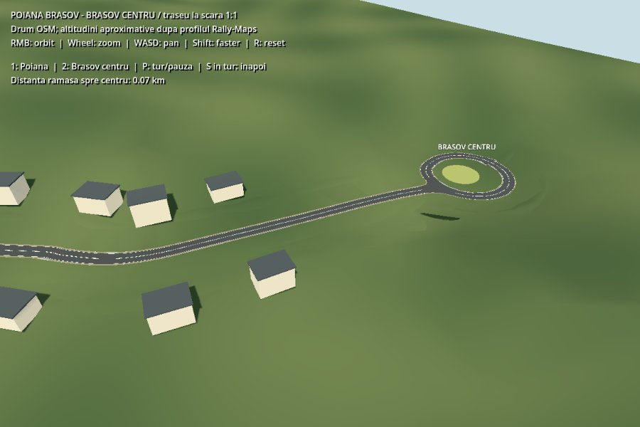
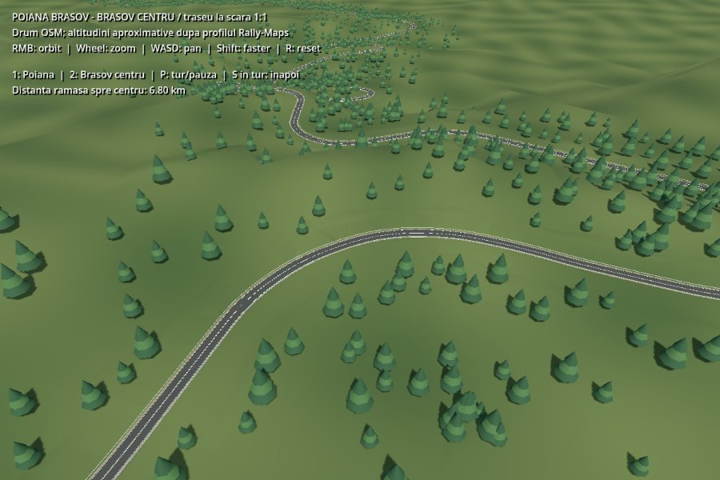

# Poiana Brașov → Brașov centre

Open [poiana_brasov_centru.tscn](../scenes/examples/poiana_brasov_centru.tscn) and press **F6**.
This separate scene retains the stylized resort and replaces its short invented
access road with an approximately **11.8 km**, **1:1** mapped road to the roundabout
near **45.64564291258261, 25.589722446492228**. The original Poiana example is retained.

- **1**: view Poiana; **2**: view the Brașov approach.
- **P**: start/pause a road-level tour toward Brașov at 50 km/h.
- **Shift** during the tour: triple speed; **S**: reverse along the route.
- Outside the tour: RMB orbits, wheel zooms, WASD pans, R restores the opening view.

The tour is a camera inspection, not a vehicle/suspension simulation. The road has
static triangle collision for later vehicle tests. Paint does not cast shadows.
The road uses World Up; curves do not introduce unintended transverse roll.
Explicitly closed World Up splines use a wrapped tangent probe at the seam, so
the final and first cross sections meet without a wedge in the collision mesh.





## Reference and accuracy

The horizontal centerline comes from **© OpenStreetMap contributors** (retrieved
12 September 2026), licensed under [ODbL 1.0](https://www.openstreetmap.org/copyright).
Way IDs and coordinates are retained in
[poiana_brasov_route.json](../../tools/data/poiana_brasov_route.json).
The approach follows the mapped Poiana road, Șirul Livezii and Bulevardul Eroilor.
The requested pin lies on/near the roundabout island, so the approach meets the
mapped carriageway instead of driving through the pin. A separate editable spline
constructs the complete roundabout.

Elevation is approximated from the 100 terrain samples in the
[Rally-Maps 2021 Poiana Brașov profile](https://www.rally-maps.com/Rally-Bra%C8%99ov-2021/Poiana-Bra%C8%99ov).
Samples are matched along the route and smoothed at uniform 10 m intervals, with
a 10% grade cap on the sampled profile before spline interpolation; the roughly final kilometre
beyond the measured stage is extrapolated and the roundabout approach is flattened.
These are not surveyed road elevations. The first 100 m at Poiana blend into the
existing authored resort, and spline interpolation rounds the map polyline.
Local Y uses a shifted altitude datum; horizontal and vertical distances use metres.

Lane layout, road width, guardrails, terrain, island shape and buildings are
simplified scenery, not a reconstruction of current traffic regulations or surveyed
street furniture. The mapped roundabout is represented by a 9 m wide road strip.

## Editing and rebuilding

`Road/DrumulPoienii` and `Road/SensGiratoriuCentru` are ordinary editable addon
splines. Terrain is embedded and does **not** regenerate merely on opening or F6;
use **Rebuild Road + Terrain** after editing the paths. Trees and scenery are
placed against the saved terrain and need refitting after terrain changes.

To rebuild this extended scene from the original Poiana scene and local route data
(overwrites manual edits to the extended scene):

```sh
godot --headless --path . --script tools/build_brasov_route.gd
```

Verify saved geometry, route joins, grades, terrain overlap, collision ray coverage
and the inspection camera:

```sh
godot --headless --path . --script tools/check_brasov_route.gd
```
