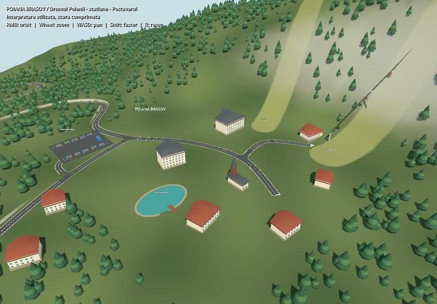
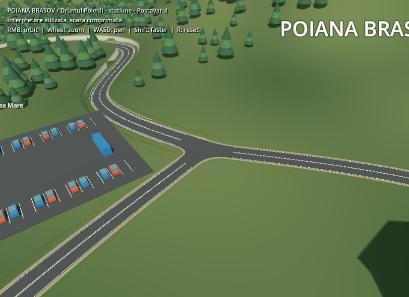

# Poiana Brașov example

Open [poiana_brasov.tscn](../scenes/examples/poiana_brasov.tscn) and press **F6**.
Right-drag orbits, the wheel zooms, WASD pans, Shift speeds up movement, and R resets.



This is a summer, stylized interpretation with compressed distances and elevations.
It is not a georeferenced reconstruction: road curves, junctions, building footprints,
ski clearings and landmark positions are authored approximations. The access routes,
Parcarea Mare and Postăvarul/Bradul/Stadion landmarks were used as context from
[Poiana Brașov's tourism site](https://poianabrasov.travel/iarna/).
The timber church silhouette is also inspired by the
[local tourism description](https://brasovtourism.app/ro/places/biserica-sf-ioan-wx75scc3eannmg).
No map imagery, elevation dataset, downloaded models or textures are bundled.

For the longer, map-based **1:1 route into Brașov centre**, see
[Brașov centre route](brasov_centru.md). It has its own scene and a road-level camera tour.

## Edit the example

- `Road/DrumulPoienii`: climbing serpentine access, widened bends and white hatching.
- Other paths under `Road`: the resort street, Râșnov exit and parking/local accesses.
  These use the addon's contour junctions. Keep joining endpoints attached when editing.
  Sloped junctions with three or more arms use an interpolated interior vertex when
  the outline supports a non-overlapping triangle fan. This avoids steep, narrow
  asphalt faces caused by triangulating only the boundary; road edges stay attached.
- `Terrain`: the addon's road-fitting terrain, with `poiana_terrain.gd` clipping
  both terrain triangles and edge collars against the final road mesh. This keeps
  the rounded junction asphalt/shoulders clear after path arms are trimmed and joined.
  Its three explicit height modifiers
  shape the eastern mountain, western ridge and flattened resort clearing.
- `Guardrail` and `GuardrailPosts`: spline deformation and MultiMesh prop placement.
- `Resort`: individually editable low-poly buildings, timber church, parking and lake.
- `Forest`: 2,800 authored ground-matched tree placements, rebuilt into spatial
  MultiMesh batches on load. CPU placement data is saved so headless scene generation
  does not lose the transforms. `Rebuild Forest Batches` reapplies those placements.

Road and terrain outputs are embedded for immediate visibility and regenerated on F6.
After changing roads, use **Rebuild Road + Terrain**. Forest placements, buildings,
lake and the cable installation are authored against the original terrain; adjust
these as well after reshaping their ground. The two summer ski clearings are painted
in `poiana_ground.gdshader` and share the forest's authored exclusion corridors.
`Invert Faces` is enabled on the road and terrain for visibility from above.
Road paint and parking stripes do not cast shadows.



## Reproduce and verify

```sh
godot --headless --path . --script tools/check_poiana_brasov.gd
```

The check covers scene reload, source/modifier persistence, upward asphalt winding,
finite geometry, hatching, shadow settings, mountain height, tree clearance and props.
It also measures polygon overlap between terrain and the final junction surfaces,
and rejects asphalt faces steeper than 12 degrees around the first climbing junction.
`tools/check_terrain_road_mesh_cut.gd` checks subtraction area, elevation interpolation,
transforms and clearing a previous cut.

To **reset the entire example**, including all manual scene edits:

```sh
godot --headless --path . --script tools/build_poiana_brasov.gd
```

The deterministic builder uses only the addon's generators and Godot primitive meshes.
